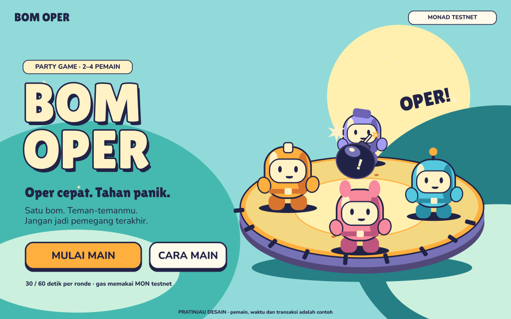

# BOM OPER

### Oper bom bareng teman. Giliran, timer, dan hasil ronde dicatat di Monad Testnet.

<p align="center">
  <a href="https://bom-oper.salmansegaf52.workers.dev/play"></a>
  <a href="https://docs.monad.xyz/"></a>
  <a href="https://www.figma.com/design/T8zhiDboW04KOC9sDJrlz6/BOM-OPER?node-id=11-60"></a>
</p>

<p align="center">
  <a href="https://github.com/salmanfidinillah/monadproject">Repo GitHub</a> ·
  <a href="https://github.com/salmanfidinillah">Profil GitHub</a> ·
  <a href="https://www.linkedin.com/in/salman-fidinillah">LinkedIn</a> ·
  <a href="https://www.figma.com/design/T8zhiDboW04KOC9sDJrlz6/BOM-OPER?node-id=11-60">Figma</a> ·
  <a href="https://bom-oper.salmansegaf52.workers.dev/play">Game live</a>
</p>

<p align="center">
  
</p>

> **Status:** aplikasi sudah dipublikasikan dan alur `/play` menggunakan kontrak Monad Testnet. Ronde dua pemain dengan receipt operan dan finalisasi belum dibuktikan, jadi MVP belum dinyatakan lulus uji multiplayer.

## Tentang game

BOM OPER adalah party game satu ronde untuk 2–4 pemain. Pemegang bom mengoper ke pemain lain sebelum waktu habis. Oper panas memangkas 3 detik dan tiap pemain dapat memakainya sekali. Saat deadline tercapai, siapa pun dapat meminta kontrak menyelesaikan ronde; pemegang terakhir kalah.

Room, giliran, deadline, dan hasil resminya mengikuti kontrak. Tidak ada taruhan atau hadiah uang. Semua pemain perlu wallet bermain dan MON Testnet untuk membayar gas.

## Mulai bermain

1. Buka [BOM OPER](https://bom-oper.salmansegaf52.workers.dev/play) di perangkat atau profil browser masing-masing.
2. Buka `/wallet`, baca persetujuan, lalu buat wallet bermain sementara. Setiap pemain harus memakai alamat berbeda.
3. Danai wallet bermain dengan MON Testnet untuk gas menggunakan wallet ekstensi atau transfer manual.
4. Pemain pertama buat room 2, 3, atau 4 orang dengan durasi 30 atau 60 detik, lalu bagikan tautannya.
5. Pemain lain buka tautan dan gabung. Setelah kursi penuh, anggota room dapat memulai ronde.
6. Pemegang bom oper ke pemain lain. Setelah waktu chain habis, tekan **Finalisasi room** dan tunggu receipt serta pembacaan hasil kontrak.

Jika transaksi masih pending atau receipt belum diketahui, gunakan **Periksa receipt**. Jangan membuat wallet baru untuk mengganti identitas di room aktif.

### Wallet dan biaya

Wallet bermain adalah EOA sementara khusus testnet. Kunci disimpan di `sessionStorage` pada tab yang sama hingga 10 menit. Transaksi ditandatangani wallet bermain di browser dan memerlukan MON Testnet untuk gas; funding melalui wallet ekstensi meminta persetujuan pengguna. Ini bukan gasless atau session key. Jangan gunakan wallet tersebut untuk aset bernilai dan jangan bagikan seed/private key.

## Jaringan dan kontrak

| Detail | Nilai |
|---|---|
| Jaringan | Monad Testnet |
| Chain ID | `10143` |
| Kontrak | [`0x18097A160477E49d52A5A637d51D6B831144aDDd`](https://testnet.monadvision.com/address/0x18097A160477E49d52A5A637d51D6B831144aDDd) |
| Receipt deploy | [Lihat transaksi](https://testnet.monadvision.com/tx/0x2ea47703572772f2f32ccb65421b921ebf728b62008fc41c0340d8deb879ed82) |
| Game | [bom-oper.salmansegaf52.workers.dev/play](https://bom-oper.salmansegaf52.workers.dev/play) |

Receipt deploy berhasil dan bytecode kontrak cocok dengan artifact proyek. Belum ada receipt publik untuk room, operan, atau finalisasi. Detail dan status pemeriksaan ada di [record deployment](deployments/10143.json), [STATUS.md](STATUS.md), dan [TEST-RESULTS.md](TEST-RESULTS.md).

## Desain dan teknologi

- [Desain Figma yang bisa diedit](https://www.figma.com/design/T8zhiDboW04KOC9sDJrlz6/BOM-OPER?node-id=11-60) — opening, lobby, arena, hasil, dan tampilan mobile.
- Frontend: React, Vite, TypeScript, ethers v6.
- Kontrak dan tool pengembangan: Solidity, Hardhat.
- Hosting: Cloudflare Workers Static Assets.

## Jalankan lokal

> Prasyarat dan versi mengikuti `package-lock.json`. Perintah berikut tersedia di konfigurasi proyek; deployment publik memerlukan sesi Cloudflare yang sudah terautentikasi.

```powershell
npm install
npm run dev
```

Pemeriksaan build dan kontrak:

```powershell
npm run build
npm run contracts:test
npm run deployment:test
```

Hasil terakhir yang benar-benar dijalankan dicatat di [TEST-RESULTS.md](TEST-RESULTS.md). Tes kontrak berjalan lokal dan bukan bukti ronde multiplayer publik.

## Dokumen proyek

| Dokumen | Isi |
|---|---|
| [SPEC.md](SPEC.md) | Aturan game dan syarat MVP |
| [STATUS.md](STATUS.md) | Status implementasi dan pekerjaan tersisa |
| [TASKS.md](TASKS.md) | Tahap kerja dan checklist |
| [docs/ARCHITECTURE.md](docs/ARCHITECTURE.md) | Struktur aplikasi dan alur transaksi |
| [docs/DECISIONS.md](docs/DECISIONS.md) | Keputusan teknis dan batasan |

## Tautan

- 🎮 [Mainkan game](https://bom-oper.salmansegaf52.workers.dev/play)
- 🎨 [Buka desain Figma](https://www.figma.com/design/T8zhiDboW04KOC9sDJrlz6/BOM-OPER?node-id=11-60)
- 💻 [Repository GitHub](https://github.com/salmanfidinillah/monadproject)
- 👤 [Profil GitHub](https://github.com/salmanfidinillah)
- 🔗 [LinkedIn](https://www.linkedin.com/in/salman-fidinillah)
